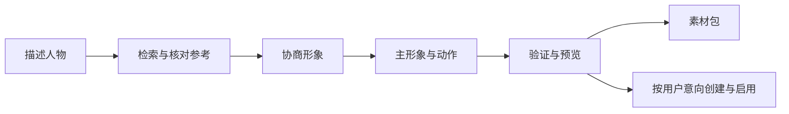

# 角色桌宠工坊 · Character-to-Pet

**安装到 agent 中使用的 Skill。** 告诉 agent 你想要的人物形象，它会检索参考、与你确认设定、制作动画素材包，并通过宿主的 Pets 工具创建 ChatGPT 桌宠。

An installable agent skill: describe a character, research references, approve the design, and let your agent make the pet.

## 安装到你的 agent

把**本仓库的 GitHub 链接**发给支持技能安装的 agent，再复制这段话：

> 请安装这个仓库里的「角色桌宠工坊」技能，技能目录是 `skills/character-to-pet`。如果有 `$skill-installer`，请使用它安装；检查本环境的检索、imagegen 和 Pets 能力，并告诉我如何调用。

安装完成后，直接对 agent 说：

> 用角色桌宠工坊，做一个正常比例的银发狐娘桌宠。先检索两三张参考，和我确认形象后再制作，做好后创建并启用。

支持 `$` 技能调用的环境也可以输入 `$character-to-pet`。技能选择方式随宿主而异，见 [官方技能说明](https://learn.chatgpt.com/docs/build-skills)。

如果喜欢下载文件，可以从仓库 **Releases** 下载 `character-to-pet.zip`，按宿主支持的技能导入方式安装。完整目录结构、ZIP 安装和更新方法见 [安装到 agent](docs/install-in-agent.md)。

日常使用在 agent 的对话中完成；安装位置、脚本调用与依赖检查由 agent 处理。



## 能做什么

- 针对具体角色检索参考，保留作者、来源与图片身份线索。
- 遵守“先准备，确认后再生成”，记住已确认的比例、服装和启用偏好。
- 配合宿主的图像生成与 Pets 制作工具，制作九组动作和十六个视线姿态。
- 输出主形象、透明图集、GIF/MP4 预览、来源、提示词与检查记录。
- 区分“素材完成”“已创建”“已选中”“浮层已显示”，避免只凭 active ID 宣告显示成功。

本项目面向 **ChatGPT 内的宠物**。图片生成与账号操作由宿主工具执行；仓库提供技能指令及本地辅助脚本。

## 适用环境

| 阶段 | 所需能力 |
| --- | --- |
| 检索与设定 | 支持技能的 agent，以及网页/图片检索能力 |
| 图像与动画制作 | 内置 imagegen、当前版本 `work-pets:create-pet` 及其制作/验证脚本 |
| agent 执行辅助脚本 | 宿主可运行 Python 3.10+、Pillow；MP4 预览另需 FFmpeg |
| 创建与启用 | 当前账号可用的 Pets 工具与对应客户端功能 |

完整制作优先适配具备上述能力的 ChatGPT Work / Codex 环境。其他兼容 Skills 的 agent 可以加载技能，但能做到哪一步取决于它实际拥有的工具。Pets 的可用性、显示方式和上传机制依赖宿主版本；agent 会定位当前安装的制作技能与验证器。缺少创建工具时交付素材包，缺少图像生成能力时先完成检索与设定。

## 在对话中使用

只准备材料：

> 用 $character-to-pet，检索这个角色的设定图并整理方案，等我确认后再生成，不要改动现有宠物。

或只制作素材包：

> 用 $character-to-pet，按已确认的参考制作动画素材包，暂时不要创建或启用。

如果用户已选定参考并授权制作，agent 会沿用决定继续，不在每组动作前重复确认。

## agent 会交付什么

一次完整流程通常交付：

```text
character-pet/
├── main-look.png
├── spritesheet.png
├── contact-sheet.png
├── directions.png
├── previews/
│   ├── all-states.gif
│   ├── all-states.mp4
│   ├── idle-jump-idle.gif
│   └── look-loop.gif
└── character-pet-materials.zip
```

素材包包含所选源图、来源、提示词、真实 QA 报告和稳定宠物元数据。未获得创建授权或工具不可用时，只交付本地包，并保留“尚未创建”的状态。

## 仓库与技能包

供用户安装的内容位于 `skills/character-to-pet/`。Releases 中的技能 ZIP 只包含这个完整技能文件夹及许可，agent 可以直接安装和读取。

```text
skills/character-to-pet/  技能、参考指引与辅助脚本
tools/                   维护用安装、打包与结构检查
tests/                   离线功能测试
docs/                    agent 安装、排错和发布说明
.github/                 CI 与问题模板
```

维护者的测试、打包命令和辅助脚本说明见 [CONTRIBUTING.md](CONTRIBUTING.md)。仓库配置了离线 CI，覆盖安装、输入保护、素材归档和预览等行为。

## 排错与反馈

见 [排错说明](docs/troubleshooting.md)。若拖动后短暂显示 Mini，应分别核对账号选中项、图集和客户端显示状态；这一现象的根因尚未确诊，本项目不宣称修复了客户端渲染问题。

发布仓库可参照 [上传 GitHub](docs/publishing.md)。贡献改动见 [CONTRIBUTING.md](CONTRIBUTING.md)。

## 许可与来源

代码与本项目原创技能说明采用 [MIT License](LICENSE)。角色、参考图片、生成素材与外部工具各自的权利范围独立；仓库未附带本次个人宠物、第三方角色图、账号数据或官方 Pets 脚本。

本项目是社区工作流，与 OpenAI 无隶属或背书关系。外部依赖与官方文档入口见 [THIRD_PARTY.md](THIRD_PARTY.md)。
